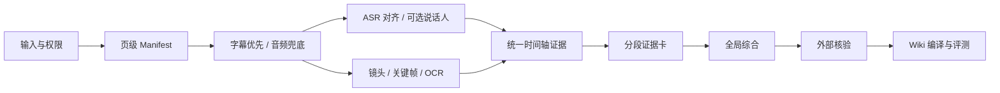

# B站视频蒸馏 SOP

> 视频蒸馏不是“把视频压成一篇摘要”，而是把视频编译成一组可回看、可核验、可重新生成的证据与知识。原始字幕、音频、关键帧和元数据是 source of truth；摘要、知识卡和 wiki 页面都是可替换的派生产物。

## 当前结论

原流程来自遗留说明 `C:\Users\jasonlyan\.claude\projects\C--Users-jasonlyan\memory\bilibili_video_to_kb_pipeline.md`，不是本轮已验证的代码。说明记录的历史实现位置为 `D:\工作\Crawler\MOBA_Related`；2026-08-27 核对时，该目录已不存在，不能再把旧路径当作可运行管线。

旧链路的主体是：

`BV 清单 → 音频 → Qwen3-ASR → LLM 修复 → distill buckets → Markdown → 知识库`

方向没错，缺的是生产契约。2026-07 的迁移日志记录了首批 764 篇；2026-08-27 当前扫描口径是 `raw/notes/moba-asr/**/*.md` 下 794 份 Markdown，其中 772 份记录了 ASR 模型，另外 22 份主要是索引/管理文件。这 772 份转写里只有 2 份出现时间轴格式，0 份形成 `aid/cid/content_hash` frontmatter 字段。历史质量审计还记录过编码损坏、过短产物和超时误判。因此 2.0 的重点不是继续追求吞吐，而是补齐页级身份、时间证据、选择性视觉信息、质量门、幂等恢复和评测。

证据位置：`log.md` 的“2026-07-12 ingest | 双 vault 合并 + B站 ASR 全量迁移”。当前统计可在 vault 根目录复跑：

```powershell
$files = Get-ChildItem -LiteralPath '.\raw\notes\moba-asr' -Recurse -File -Filter '*.md'
$asr = (Select-String -Path $files.FullName -Pattern '^asr_model:' -List).Count
$timed = (Select-String -Path $files.FullName -Pattern '\[\d{2}:\d{2}' -List).Count
$identity = (Select-String -Path $files.FullName -Pattern '^(aid|cid|content_hash):' -List).Count
[pscustomobject]@{Markdown=$files.Count; ASR=$asr; WithTimeline=$timed; WithIdentityContract=$identity}
```

## 一句话流程



## 处理档位

| 档位 | 适用条件 | 必做 | 可省略 |
|---|---|---|---|
| 快速摘录 | 短视频、低风险、内容主要靠口播、已有完整字幕 | 页级 manifest、原字幕、时间轴、证据卡、来源链接 | 说话人、视觉 OCR、外部事实核验 |
| 标准蒸馏（默认） | 一般访谈、教程、解读 | 字幕/ASR、对齐、选择性关键帧、两级蒸馏、抽样校准、知识库编译 | 单人视频可省说话人分离 |
| 高保真 | 长视频、多人、幻灯片/演示/游戏画面、重要复用或高风险事实 | 全部阶段、视觉通道、外部核验、人工发布门、回归评测 | 无 |

不能因为视频短就自动走快速档；只要关键信息主要在画面、数字风险高或需要正式引用，就升级。

## 阶段 0：确认输入、范围和使用边界

1. 输入先规范化为 canonical BVID；短链和分享链接只保留为 `submitted_url`。
2. 记录任务目的：快速了解、完整学习、专题语料、正式引用或知识库长期维护。
3. 确认是否有权处理该视频。付费、会员、地区限制、下架或私密内容不绕过权限；必要时让用户提供其有权处理的本地文件。
4. 识别视频类型：单人口播、多人访谈、幻灯片、软件演示、游戏画面、混合型。它决定是否启用说话人和视觉通道。

## 阶段 1：建立页级 Manifest

B站多 P 视频必须先展开 `pages`。最小处理单元不是一个中文标题，也不只是 BVID，而是：

`bilibili:{bvid}:p{page}:cid{cid}`

Manifest 至少记录：

```yaml
source_id: bilibili:BVxxxx:p1:cid123
submitted_url: https://...
canonical_url: https://www.bilibili.com/video/BVxxxx?p=1
bvid: BVxxxx
aid: 0
cid: 123
page: 1
part: 分P标题
duration_ms: 0
captured_at: 2026-08-27T00:00:00+08:00
acquisition_route: opencli-subtitle | bili-audio-asr
tool_versions: {}
artifact_hashes: {}
status: DISCOVERED
```

合集/系列要先枚举成员 BVID，再逐个展开 page/cid。缓存、重试、错误记录和发布都以 `source_id` 为主键。

## 阶段 2：按“字幕优先”获取 Source Pack

采集默认顺序：

1. 原始演讲/作者提供、人工校对的字幕或 transcript；
2. UP 主提供或确认过的字幕；
3. 平台自动字幕；
4. 本地 ASR。

这个顺序用于降低重复下载与转写成本，不代表平台自动字幕的质量必然高于本地 ASR。两者都保留；抽样校准或本地金标若显示本地 ASR 更好，就用 ASR 作为 normalized 主轨。

每条轨都必须标明 `human/creator/platform_auto/translated/local_asr`，不能把自动字幕伪装成人工原文。[Google YouTube Help（无发布日期）](https://support.google.com/youtube/answer/6373554?hl=en) 的原文提醒是 “automatic captions might misrepresent the spoken content”；这条能力边界同样适用于 B站自动字幕和本地 ASR。

2026-08-27 本机验证的 B站只读降级链：

1. `agent-reach doctor --json` 只负责选后端，不代表目标视频已成功；
2. `bili search` / `bili video` 获取搜索、详情和基础元数据；
3. 展开每个 page/cid；
4. `opencli bilibili subtitle BV...` 取字幕；必须实际拿到非空、带时间轴的文本才算成功；
5. 字幕为空时先检查 OpenCLI 桥接并受控重试一次；匿名字幕接口为空只代表 `UNKNOWN`，不能直接判定 `ABSENT`；
6. 仍无字幕时用 `bili audio` 获取 ASR-ready 音频，再交给本地 ASR 或 `agent-reach transcribe`；
7. 当前不要把 `yt-dlp + cookies` 直抓 B站作为默认路径；[Agent Reach 维护者代码记录](https://github.com/Panniantong/Agent-Reach/blob/main/agent_reach/channels/bilibili.py)称该路线在 2026-06 多种配置下持续触发 412。本轮遵守路由规范，没有独立复现 412。

Source Pack 保存原始 metadata、原字幕、音频或音频哈希、封面、描述、章节、采集错误与工具版本。评论、弹幕属于受众信号，单独存放，不能混进视频事实证据。

### 当前可执行的最小命令链

以下是 PowerShell 手工 runbook；正式 driver 恢复后也必须产出同样的 artifact。`<work_root>` 默认放在 vault 外，例如 `../.video-work/bilibili/`，避免把媒体和临时状态提交进知识库。

```powershell
$bvid = "BVxxxxxxxxxx"
$videoRoot = "..\.video-work\bilibili\$bvid"
$videoSourceDir = Join-Path $videoRoot "source"
New-Item -ItemType Directory -Force -Path $videoSourceDir | Out-Null

agent-reach doctor --json
bili video $bvid | Tee-Object -FilePath (Join-Path $videoSourceDir "metadata.bili.txt")

# 非正式 web API，仅用于 best-effort 展开 page/cid；保存原响应供适配器变更时追溯。
$view = Invoke-RestMethod -Uri "https://api.bilibili.com/x/web-interface/view?bvid=$bvid"
$view | ConvertTo-Json -Depth 30 | Set-Content -LiteralPath (Join-Path $videoSourceDir "view.raw.json") -Encoding utf8

$pages = @($view.data.pages)
foreach ($p in $pages) {
    $pageRoot = Join-Path $videoRoot ("p{0:D3}-cid{1}" -f [int]$p.page, $p.cid)
    New-Item -ItemType Directory -Force -Path (Join-Path $pageRoot "source"), (Join-Path $pageRoot "transcript") | Out-Null
    [ordered]@{
        source_id = "bilibili:$bvid`:p$($p.page)`:cid$($p.cid)"
        bvid = $bvid; page = $p.page; cid = $p.cid; part = $p.part
        duration_ms = [int64]$p.duration * 1000; status = "DISCOVERED"
    } | ConvertTo-Json | Set-Content -LiteralPath (Join-Path $pageRoot "manifest.seed.json") -Encoding utf8
}

# 当前只验收过单 P 目标。多 P 的 OpenCLI/bili audio page selector 尚未验证，必须停住。
if ($pages.Count -ne 1) { throw "NEEDS_IMPLEMENTATION: multi-P page-targeted subtitle/audio adapter" }

$page = $pages[0]
$taskRoot = Join-Path $videoRoot ("p{0:D3}-cid{1}" -f [int]$page.page, $page.cid)
$sourceDir = Join-Path $taskRoot "source"
$transcriptDir = Join-Path $taskRoot "transcript"
opencli bilibili subtitle $bvid | Tee-Object -FilePath (Join-Path $sourceDir "subtitle.opencli.txt")
```

当前匿名 web API 只能 best-effort，不能视为正式 SLA。多 P 已建立每页目录和 seed manifest，但在页级字幕/音频适配器完成目标级验收前，状态必须保持 `NEEDS_IMPLEMENTATION`。单 P 字幕命令没有返回实质文本时：

```powershell
Push-Location $taskRoot
bili audio $bvid
Pop-Location

# 对 bili audio 产出的本地音频执行；需要已显式配置转写 provider。
agent-reach transcribe "<local-audio-path>" -o (Join-Path $transcriptDir "transcript.raw.txt")
```

如果没有可用 provider，状态写 `NEEDS_INPUT`，不要伪造转写完成。高保真视觉处理还需要用户有权处理的本地视频文件；只有音频时必须把视觉覆盖标为 gap，不能声称完成高保真档。

### Artifact 目录与核验记录

```text
<work_root>/bilibili/<bvid>/
├── source/metadata.bili.txt
├── source/view.raw.json
└── p<page>-cid<cid>/
    ├── manifest.json
    ├── source/subtitle.opencli.txt
    ├── source/audio.sha256
    ├── transcript/segments.raw.json
    ├── transcript/segments.normalized.json
    ├── visual/scenes.json
    ├── visual/frames.jsonl
    ├── evidence/cards.jsonl
    ├── verification/claims.jsonl
    └── publish/receipt.json
```

`verification/claims.jsonl` 每条至少包含：

```json
{
  "claim_id": "claim-001",
  "evidence_ids": ["BVxxxx:p1:000123"],
  "claim_type": "quote | paraphrase | inference | opinion | external_fact",
  "verification_status": "single_source | probable | likely | confirmed | disputed | pending",
  "external_sources": [{
    "url": "https://...",
    "title": "...",
    "publisher": "...",
    "published_at": "YYYY-MM-DD | YYYY-MM | YYYY | unknown",
    "source_type": "official | first-party | secondary | ugc | suspicious",
    "tier": "S | A | B | C | D | X",
    "quote": "...",
    "independence_group": "origin-1"
  }],
  "reviewer": "...",
  "reviewed_at": "2026-08-27T00:00:00+08:00",
  "notes": ""
}
```

只有至少两个不同 `independence_group` 的 Tier A+ 来源才能标 `confirmed`；单一官方/一手来源也必须标 `single_source` 或至多 `probable`。`publish/receipt.json` 记录最终 source/entity/topic/index/log/graph 产物、校验结果与上游 hash。视觉阶段未启用时保留显式 `skipped_reason`，不要创建假成功文件。

## 阶段 3：ASR、时间对齐与说话人

1. 先跑音频完整性检查：可解码、非零、时长与对应 page 基本一致。
2. 采用 VAD/语音边界切段，避免固定时长直接切断一句话；分块保留少量重叠并在合并时去重。
3. 中文主模型可以继续用 Qwen3-ASR，但“支持某语言/方言”不等于在本地 B站语料上最好。必须用本地金标集选型。
4. Qwen3 ForcedAligner 官方限制单段最长 300 秒；需要时间轴时，先把长音频切成不超过 5 分钟的块，再把局部时间映射回全局。
5. 单人视频默认不装说话人分离；多人访谈、圆桌或对话才启用 pyannote/WhisperX 一类的 diarization，并记录授权和模型依赖。
6. `raw_text` 永不覆盖。LLM 只能生成 `normalized_text`，用于标点、分段和受词表约束的专名校正；保存 diff、模型和 prompt 版本。
7. 标题、简介、PPT、原视频链接和已知实体可形成校准词表，但热词注入必须先 A/B 测试。本地证据见 `log.md` 的“2026-07-09 enhance | 句子合并完成 + 说话人分离受阻 + 废弃清理”：该次 `initial_prompt` 实测诱发整段幻觉；它是一次本地案例，不代表所有模型/配置必然如此。

转写最小字段：`segment_id/start_ms/end_ms/speaker/language/confidence/raw_text/normalized_text/source_type`。

## 阶段 4：视觉证据通道

只做音频会系统性漏掉幻灯片数字、图表、代码、产品演示、游戏 UI 和画面反例。成熟视频索引产品会同时输出 transcript、speaker、OCR、shot、keyframe 和时间范围；Video-MME 也表明音频与字幕为长视频理解补充了关键内容。

默认采用选择性视觉处理：

1. 用镜头/画面变化检测发现 scene 和 slide change；
2. 每个 scene 取代表帧，不使用“整段固定抽 N 帧”作为长视频默认；
3. 只对代表帧、文字密集帧和变化帧跑 OCR；
4. OCR 保存原图哈希、时间点、文本、坐标和置信度；
5. 图表、界面和玩法信息不能只靠 OCR 时，再让视觉模型解释，但输出仍要指向原帧。

轻量实现候选可以是 PySceneDetect + PaddleOCR；它们是可替换的窄模块，不需要引入整套 VideoRAG 平台。本轮只分别核对了两个项目的能力，没有在本机视频上验证这一组合的召回率和工程兼容性。

拿到有权处理的本地视频后，scene/keyframe 的最小试跑命令可以是：

```powershell
scenedetect -i "<local-video-path>" -o "$taskRoot\visual" detect-content list-scenes save-images
```

当前仓库没有已经验收的 PaddleOCR 包装器。接入前先用金标帧验证，再把 OCR 输出统一成 `frame_id/time_ms/text/bbox/confidence/model_version/image_hash`；未通过验证就保持 `NEEDS_IMPLEMENTATION`。

## 阶段 5：统一成时间轴证据

把 transcript、speaker、OCR、keyframe、chapter 和 metadata 合并为稳定的 `evidence_span`。示例：

```json
{
  "evidence_id": "BVxxxx:p1:000123",
  "source_id": "bilibili:BVxxxx:p1:cid123",
  "cid": 123,
  "page": 1,
  "start_ms": 215000,
  "end_ms": 231000,
  "speaker": "SPEAKER_01",
  "language": "zh",
  "source_type": "platform_auto",
  "raw_text": "...",
  "normalized_text": "...",
  "raw_hash": "sha256:...",
  "visual_refs": ["frame-00042"],
  "kind": ["claim", "example"],
  "confidence": null,
  "confidence_basis": "not_calibrated",
  "source_url": "https://www.bilibili.com/video/BVxxxx?p=1&t=215"
}
```

后续任何知识产物只引用 `evidence_id`，不再直接引用一份无法定位的长纯文本。

## 阶段 6：质量门

| 门 | 必须通过的检查 | 失败处理 |
|---|---|---|
| G1 获取完整性 | BVID/page/cid 齐全；字幕或音频为非空；媒体可解码 | 回到降级链，不进入蒸馏 |
| G2 时间覆盖 | 时间戳单调；结尾覆盖接近媒体时长；初始工程阈值建议 `max(15 秒, 1%)`，再由金标数据校准 | 检查截断、错页、合并偏移 |
| G3 文本质量 | 无大段空白/重复/乱码；抽查开头、中段、结尾；专名和高风险数字抽样复听 | 标记低置信或重转，不静默修复 |
| G4 视觉覆盖 | 幻灯片/演示/游戏类视频有关键帧；视觉独有事实能回到帧 | 补取 scene/keyframe/OCR |
| G5 证据覆盖 | 每条关键结论有 evidence_id 和时间链接；无证据结论率为 0 | 降为 inference 或删除 |
| G6 发布完整性 | 高风险事实已核验或进入待核验；双链、索引、日志可解析 | 不发布到综合结论 |

超时、OOM、412 或桥接失败只能进入可重试状态，不能永久拉黑。历史上“45 分钟超时后误写 skip”正是需要取消的失败模式。

## 阶段 7：三遍蒸馏

### 第一遍：分段证据卡

按章节、话题、说话人、停顿和镜头变化切语义段。每段抽取：

- 章节标题与时间范围；
- 原子主张、定义、方法、步骤、例子、反例；
- 数字、人名、公司、产品、论文和专有术语；
- 前提、因果链、立场、异议和 ASR 疑点；
- 原文 quote、evidence_id、视觉引用与置信度。

### 第二遍：全局综合

全局模型只能读取证据卡，不直接“凭印象”重读整条长文本。它负责去重、恢复时间线、组织论证、保留少数意见和显式矛盾，并产出章节级覆盖清单。

长视频 benchmark 和层级视频研究都显示，视频越长，冗余和无关信息越容易压垮单次推理；“分段证据卡 → 全局综合”是可靠性控制，不是为了堆 agent。

### 第三遍：外部核验

严格区分：

- `quote`：讲者原话；
- `paraphrase`：忠实改写；
- `inference`：蒸馏模型推论；
- `opinion`：讲者/UP 主观点；
- `verified_fact`：已由独立来源核实；
- `pending_verification`：尚未核实。

数字、公司案例、论文结论、融资估值、绩效指标、职位头衔和历史事件，核验前只能进入 `03-核验/待核验事实.md`。

## 阶段 8：编译进知识库

一次完整入库至少产生或更新：

1. `raw/`：不可变 Source Pack 或可定位的外部原件；
2. `wiki/sources/`：带证据与归因边界的素材页；
3. `wiki/entities/`：按现有知识库 ingest 规则通常提取 3-5 个可复用实体；这不是行业固定配额；
4. `wiki/topics/`：把新信息接入已有主题；
5. `03-核验/待核验事实.md`：未核事实和 ASR 疑点；
6. `index.md`、`log.md`，必要时 `wiki/overview.md`；
7. 知识网络变化时重建 graph，并执行 lint。

“生成了一篇 Markdown”不是完成。完成标准是：原始证据可回看、关键结论可定位、高风险事实被隔离、知识网络已更新。

## 阶段 9：幂等、恢复和版本化

状态机：

`DISCOVERED → ACQUIRED → TRANSCRIBED → ALIGNED → EVIDENCED → DISTILLED → VERIFIED/PENDING → PUBLISHED`

失败状态只允许：`FAILED_RETRYABLE`、`NEEDS_INPUT`、`REJECTED_WITH_REASON`。

每阶段单独落 artifact 和 `manifest.json`，记录：

- `input_hash`、`output_hash`；
- tool/model/prompt/schema version；
- started/finished、status、metrics、error；
- 上游 artifact ID 和下游产物列表。

哈希一致就复用；失败只重跑当前阶段；写入先到临时文件，校验通过再原子替换。无需先上 Airflow、Dagster 或完整 RAG 平台。

## 阶段 10：评测与升级门

先用 12-20 条代表性本地视频作为启动规模，覆盖普通话、方言/噪声、中英混说、多人重叠、幻灯片、软件演示、游戏画面、长访谈和多 P。这个数量是便于人工标注的工程起点，不是统计学标准；根据错误分布继续扩充。

分层评测：

- 转写：中文 CER/英文 WER、专名与数字正确率、空白/重复率；
- 对齐：时间覆盖率、边界误差、未对齐 token；
- 说话人：多人视频的 DER 与人工抽查；
- 视觉：关键帧覆盖、OCR precision/recall、视觉独有事实召回；
- 蒸馏：关键结论证据覆盖率、无证据结论率、矛盾保留率、问答回归正确率；
- 运营：成功率、重试率、人工修正量、单小时视频耗时和成本。

模型、prompt、切段或工具升级只有在金标集不回退时才能成为默认；旧 artifact 和版本继续保留以便回滚。

## 从旧流程升级的优先级

### P0：先把结果变得可信

1. BVID 升级为 BVID + page + cid 的稳定身份；
2. 新增 manifest、内容哈希和阶段状态；
3. raw/normalized 双层，禁止 LLM 覆盖原文；
4. 每条证据补时间轴，蒸馏改成“证据卡 → 全局综合”；
5. 加 G1-G6 发布门；超时不再永久 skip；
6. B站入口改为 bili-cli/OpenCLI/bili audio 降级链，停止默认 yt-dlp 直抓。

### P1：补回视频本来就有的信息

1. 幻灯片、演示和游戏类视频启用 scene/keyframe/OCR；
2. 多人视频按需启用 diarization；
3. 高风险事实走独立核验；评论/弹幕独立为受众信号。

### P2：再扩大规模

1. 建金标集与回归报告；
2. 按价值/质量评分选片，不盲目扩张 ASR 数量；
3. 观察真实失败数据后再调并发、退避和模型路由。

## 验收清单

- [ ] 所有 page/cid 都已枚举，没有漏 P；
- [ ] 原字幕/ASR、normalized 文本和哈希都在；
- [ ] 字幕或转录覆盖开头、中段、结尾；
- [ ] 视觉依赖内容有关键帧/OCR；
- [ ] 每条关键结论可在 1 分钟内回跳到原视频证据；
- [ ] 讲者原话、UP 主扩展、模型推论和外部事实已分开；
- [ ] 高风险事实已核验或进入待核验；
- [ ] 入库不止新增摘要，相关实体、主题、索引和日志已同步；
- [ ] 失败可恢复、重复运行不重复下载/转写/发布；
- [ ] 当前模型与 prompt 已通过本地金标集非回退检查。

## 参考依据与能力边界

- [Agent Reach 视频路由](https://github.com/Panniantong/Agent-Reach/blob/main/agent_reach/skill/references/video.md)：当前 B站搜索/详情/字幕/音频降级链；属于高时效工具事实，运行前重做 doctor 和目标视频实测。
- [Qwen3-ASR](https://github.com/QwenLM/Qwen3-ASR)：多语 ASR、长音频和 ForcedAligner；模型卡是厂商自报，不等于本地 B站场景最优。
- [WhisperX 论文](https://www.robots.ox.ac.uk/~vgg/publications/2023/Bain23/bain23.pdf)：VAD、批量转写、强制对齐与说话人归属的成熟组合模式。
- [Azure AI Video Indexer 输出](https://learn.microsoft.com/en-us/azure/azure-video-indexer/video-indexer-output-json-v2)：transcript/OCR/shot/keyframe/speaker/time range 的成熟输出范式；只能证明能力结构，不证明精度最佳。
- [Video-MME](https://arxiv.org/html/2405.21075)：长视频、多模态与稀疏采样的持续难点；论文来自 2024 年，不用于声明 2026 模型排名。
- [Adaptive Keyframe Sampling, CVPR 2025](https://openaccess.thecvf.com/content/CVPR2025/papers/Tang_Adaptive_Keyframe_Sampling_for_Long_Video_Understanding_CVPR_2025_paper.pdf)：自适应关键帧优于固定均匀采样的研究证据。
- [PySceneDetect](https://github.com/Breakthrough/PySceneDetect) 与 [PaddleOCR](https://github.com/PaddlePaddle/PaddleOCR)：选择性视觉通道的轻量实现候选。

本轮有限检索没有找到独立的 2025-2026 B站中文 ASR 横评，也没有找到同时覆盖 B站获取、ASR、视觉、可恢复执行、证据化蒸馏和 Wiki 发布且维护/许可证边界清楚的成熟单体项目。这不等于全行业绝对不存在。本 SOP 因而把本轮最有证据支持的方向定义为可替换模块之间的证据契约和质量门，而不是某一个模型或仓库。

尚未实测的关键项：OpenCLI 字幕对音轨的逐字准确率；`bili audio → ASR` 的端到端落盘链；PySceneDetect + PaddleOCR 组合；合集/番剧/互动/付费/地区限制；匿名接口的恢复窗口。执行时必须把这些保留为 gap。
