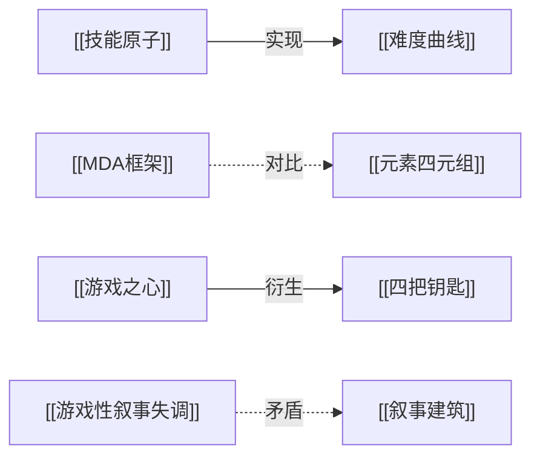

# 库结构说明

> 这一页解释目录为什么这么分、页面之间怎么连、什么时候该新建什么。先读它，再改结构。

## 目录职责

四条线不重叠，每条只有一个职责：

| 目录 | 职责 | 写入方 | 可变性 |
| --- | --- | --- | --- |
| `01-原始素材/` | 原始素材的不可变副本 | 导入工具、人工 | 只增不改 |
| `02-知识库/素材/` | 一素材一摘要，让素材可被引用 | LLM 编译 | 可重写 |
| `02-知识库/概念/` | 一概念一页，可复用的知识单元 | LLM 编译 | 可重写 |
| `02-知识库/主题/` | 一问题一页，组织跨素材观点 | LLM 编译 | 可重写 |
| `02-知识库/对比/` | 两者的横向对比 | LLM 编译 | 可重写 |
| `02-知识库/综合/` | 跨素材的阶段性结论 | LLM 编译 | 可重写 |
| `00-入口/` | 导航层（首页 + 四张 MOC） | 人工 | 随结构演化 |
| `03-核验/` | 待核验与已核验的事实台账 | 人工 + LLM | 持续更新 |
| `04-历史主题/` `05-历史视频笔记/` | 历史笔记层，只读 | 人工（历史） | 不再新增 |


这样做的好处是双链不断、历史可追溯；代价是目录看起来有冗余。这个代价是值得的——迁移会让上百条路径链接同时失效。

## 页面格式

所有 wiki 页面统一五段结构：

```markdown
---
tags: [类型, 领域, 主题词]
created: YYYY-MM-DD
updated: YYYY-MM-DD
sources: ["作者, 标题, 出处, 年份"]
---

# 页面名

> 一句话摘要，说明这一页解决什么问题。

## 核心内容

（正文，可分子标题）

## 相关页面

- [[页面A]]
- [[页面B]]
```

frontmatter 的 `sources` 是硬要求：每个观点要能追到原始出处。没有出处的观点，标 [[03-核验/待核验事实]]，不写成定论。

## 命名规范

| 类型 | 命名方式 | 例子 |
| --- | --- | --- |
| 实体页 | 中文概念名，不加书名号不加英文 | [[MDA框架]] / [[技能原子]] |
| 英文理论 | 英文缩写 + 中文限定 | [[SRK框架]] / [[OODA循环]] |
| 院校页 | 校名 + 核心内容 | [[USC游戏设计方法]] |
| 主题页 | 问题域名词 | [[游戏设计流派与争论]] |
| 素材页 | 保留原标题 | [[我克隆了3个成功App，现在月入3.5万美元]] |

不做中英混写，不用括号别名。别名只在 frontmatter 的 aliases 里加。

## 三种链接用法

| 用法 | 写法 | 什么时候用 |
| --- | --- | --- |
| 概念引用 | `[[MDA框架]]` | 正文里提到别的概念，读者可能想跳过去 |
| 带显示名 | `[[02-知识库/知识库总览\|知识库总览]]` | 路径长但想显示短名 |
| 章节引用 | `[[总索引#待补工作]]` | 指向长页面的某一节 |

关系类型（Mermaid 里用）：



四种关系：`实现` / `依赖` / `对比` / `矛盾` / `衍生`。

## 什么时候新建什么

判断顺序很重要，从下往上问：

1. 这是个具体素材（视频/文章/论文）→ 建 `02-知识库/素材/` 一页。
2. 这是个可以脱离素材独立成立的概念 → 建 `02-知识库/概念/` 一页。
3. 这是个需要组织多个概念来回答的问题 → 建 `02-知识库/主题/` 一页。
4. 这是跨多个素材得出的阶段性结论 → 建 `02-知识库/综合/` 一页。
5. 这是两条路径的取舍 → 建 `02-知识库/对比/` 一页。

常见错误是跳过「概念」直接建「主题」，结果主题页里塞满定义，既不好查也不好维护。

## 导航层怎么维护

导航层只有五个文件，改动的判断标准很窄：

| 文件 | 什么时候改 |
| --- | --- |
| [[首页]] | 新增或删除一条主线时 |
| [[游戏设计MOC]] | 新增理论页、院校页、业界信条时 |
| [[AI组织MOC]] | 新增主题或核心概念时 |
| [[技术学习MOC]] | 新增学习路线或项目页时 |
| [[独立开发MOC]] | 新增案例或方法论页时 |
| [[总索引]] | 每次 ingest 都改，它是全量清单 |

MOC 与 index 的分工：index 是清单（有什么），MOC 是地图（怎么走）。两者都要有，不要合并。

## 定期检查

每次较大规模写入后跑一遍：

| 检查项 | 判据 | 处理 |
| --- | --- | --- |
| 孤立页面 | 没有入链也没有出链 | 补链接或并入其他页 |
| 断链 | `[[X]]` 中 X 不存在 | 建页或改链 |
| 索引不一致 | 总索引里有但文件不存在，或反之 | 补齐 |
| 概念重复 | 两个页面讲同一件事 | 合并，保留一个 |
| 停滞综合 | 综合页超过 3 个月未更新 | 重读素材或标记过期 |
| 素材孤岛 | 原始素材里有但没编译 | 补素材摘要页 |

已知的存量问题：`04-历史主题/` 与 `05-历史视频笔记/` 里有 27 处历史断链，涉及 `实体/Metroidvania类型`、`叙事与玩法的背离`、`BV号` 等占位链接。这些属于历史层，不阻断使用，但不要在新建页面里模仿这种写法。

## 相关页面

- [[首页]]
- [[总索引]]
- [[知识库规范|知识库规范]]
- [[操作日志]]
