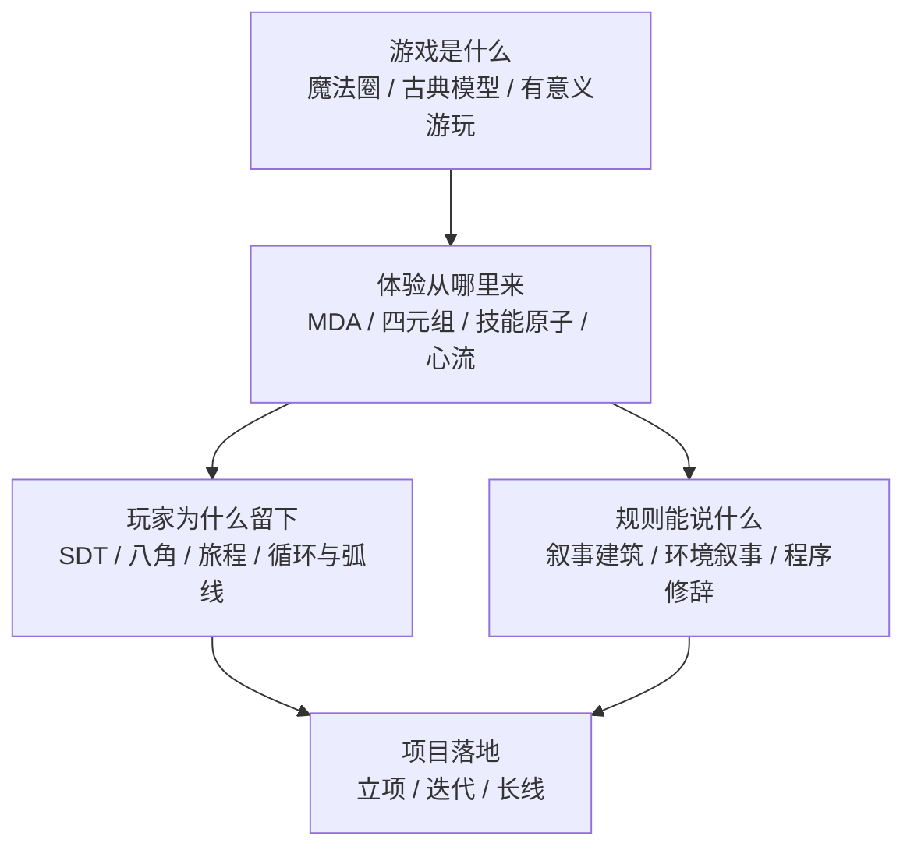

# 游戏设计理论谱系

> 把游戏设计的主要理论按「回答什么问题」串成一条线：从「游戏是什么」，到「体验怎么产生」，到「玩家为什么留下」，到「规则能说什么」。

## 怎么读这条谱系

现有知识库里的[[游戏设计方法]]以中文 GDC 讲座与 necromanov 深度评论为主，偏实践与案例。这一页补的是它缺的另一半：英文经典理论的原始框架。

两条线不冲突，读法上建议先用本页建立坐标系，再用[[游戏设计方法]]里的具体讲座填血肉。

一个提醒：下面的理论大多没有被严格实证验证过，它们是「被行业反复使用的思考工具」，不是科学定律。每页都标注了原始出处和主要批评，读时不要跳过批评部分。

第二个提醒：本页按「回答什么问题」分层，看起来像学界已有共识——其实没有。USC 教你如何把体验做对，CMU 教你把东西做出来，NYU 教你质疑为什么要做；产业界一句「游戏是一系列有趣的选择」和一句「游戏是玩家的自我表达」可以同时成立又互相拆台。这些分歧不是错误，见 [[游戏设计流派与争论]]。

## 第一层：游戏是什么

这一层回答本体问题，产出的是一套共同词汇。

| 理论 | 年份 | 核心贡献 | 页面 |
| --- | --- | --- | --- |
| 赫伊津哈的游戏论 | 1938 | 游戏先于文化；魔法圈 | [[魔法圈]] |
| 凯卢瓦的四分类 | 1958 | agon/alea/mimicry/ilinx；paidia↔ludus | [[游戏定义]] |
| 苏茨的非必要障碍 | 1978 | 自愿克服非必要障碍 | [[游戏定义]] |
| Juul 的古典游戏模型 | 2003 | 六特征；涌现 vs 推进 | [[古典游戏模型]] |
| Salen & Zimmerman | 2004 | 规则冲突定义；有意义游玩 | [[有意义游玩]] |
| Schell 的定义 | 2008 | 以玩的态度解决问题的活动 | [[元素四元组]] |

阅读建议：先读[[古典游戏模型]]（最清晰的六条），再读[[游戏定义]]（看完整谱系与反例），最后读[[有意义游玩]]（学院派的系统化写法）。

## 第二层：体验从哪里来

这一层是设计实操用得最多的一层。

| 理论 | 年份 | 核心贡献 | 页面 |
| --- | --- | --- | --- |
| MDA | 2004 | 机制→动态→体验；视角不对称；八种 Fun | [[MDA框架]] |
| 元素四元组 | 2008 | 机制/故事/美学/技术四者平衡 | [[元素四元组]] |
| 设计镜头 | 2008 | 一百个提问视角 | [[设计镜头]] |
| 游戏之心 | 2004 | 乐趣=大脑学习模式 | [[游戏之心]] |
| 技能原子 | 2007 | 动作→模拟→反馈→建模 | [[技能原子]] |
| 心流 | 1975/1990 | 挑战技能匹配 | [[心流]] |
| 四把钥匙 | 2004 | 硬/易/严肃/人际四种乐趣 | [[四把钥匙]] |

这七个不是竞争关系，是不同粒度：

- 要判断整体结构 → [[MDA框架]]
- 要谈判项目范围 → [[元素四元组]]
- 要自查盲点 → [[设计镜头]]
- 要解释「为什么好玩」→ [[游戏之心]]
- 要设计单次操作手感 → [[技能原子]]
- 要调难度 → [[心流]]
- 要给团队建立体验词汇 → [[四把钥匙]]

## 第三层：玩家为什么留下

这一层是服务型游戏与商业化设计的理论基础。

| 理论 | 年份 | 核心贡献 | 页面 |
| --- | --- | --- | --- |
| 玩家类型 | 1996 | 成就/探索/社交/杀手 + 动态压制 | [[玩家类型]] |
| Nick Yee 动机模型 | 2006 | 3 组件 10 子组件 | [[玩家类型]] |
| 自我决定理论 / PENS | 1985/2006 | 胜任/自主/关联 | [[自我决定理论]] |
| 八角行为分析 | 2015 | 八个核心驱动 + 白帽黑帽 | [[八角行为分析]] |
| 玩家旅程 | 2000/2012 | 新手→上手→精通→热情 | [[玩家旅程]] |
| 循环与弧线 | 2012 | 循环维持留存，弧线提供意义 | [[循环与弧线]] |
| 奖励设计 | — | 四类奖励 + 过度理由效应 | [[游戏奖励设计]] |

关键区分：[[玩家类型]]描述「怎么玩」，[[自我决定理论]]与[[八角行为分析]]描述「为什么动」，[[玩家旅程]]描述「什么时候需要什么」，[[循环与弧线]]描述「结构怎么搭」。混用这四个会让讨论失焦。

## 第四层：规则能说什么

这一层是游戏的表达性问题，也是「游戏是不是艺术」讨论的实质内容。

| 理论 | 年份 | 核心贡献 | 页面 |
| --- | --- | --- | --- |
| 游戏学 vs 叙事学 | 1997-2004 | 规则系统 vs 叙事媒介 | [[游戏学与叙事学之争]] |
| 叙事建筑 | 2004 | 唤起/演出/嵌入/涌现四种空间叙事 | [[叙事建筑]] |
| 环境叙事 | 2000s | 六种空间叙事手法 | [[环境叙事]] |
| 游戏性叙事失调 | 2007 | 机制与叙事互相拆台 | [[游戏性叙事失调]] |
| 程序修辞 | 2007 | 规则本身有论证能力 | [[程序修辞]] |

这一层的实用产出是诊断工具：当玩家说「剧情很好但玩不下去」或「打得爽但不知道在干嘛」，问题通常落在这一层。

## 第五层：怎么把它们用在项目里

理论不能直接变成需求文档。可用的转换路径有三条：

1. 立项：用[[元素四元组]]分配预算，用[[MDA框架]]定义目标体验，用[[四把钥匙]]写体验验收标准。
2. 迭代：用[[技能原子]]找学习断点，用[[心流]]与[[难度曲线]]调节奏，用[[玩家反馈闭环]]收集证据。
3. 长线：用[[循环与弧线]]搭结构，用[[玩家旅程]]排阶段，用[[自我决定理论]]守动机底线，用[[八角行为分析]]查动机覆盖。

## 一张总图

## 与库里既有内容的关系

- [[游戏设计方法]]：中文实践层，772 篇 GDC/GMTK 转录 + 67 篇 necromanov。本页是它的理论底座。
- [[游戏设计流派与争论]]：本页讲「有哪些理论」，那一页讲「这些理论之间怎么打架」——三所院校方法论对比、业界六组对立、SRK 的位置都在那里。两页互为坐标系。
- [[系统与策略设计]]、[[开放世界设计]]、[[RPG设计]]、[[游戏叙事设计]]、[[动作游戏设计史]]、[[游戏经济与商业化]]：六个中文子主题，各自的英文理论支撑可在本页对应层找到。
- [[AI游戏与虚拟世界]]：当 AI 进入设计流程后，上述框架哪些仍然有效、哪些需要重写，是另一个问题，见[[AI与人类独特性]]。

## 相关页面

- [[游戏设计方法]]
- [[游戏设计流派与争论]]
- [[游戏定义]]
- [[MDA框架]]
- [[技能原子]]
- [[自我决定理论]]
- [[叙事建筑]]
- [[游戏学与叙事学之争]]
- [[程序修辞]]
- [[SRK框架]]
- [[USC游戏设计方法]]
- [[CMU娱乐技术中心]]
- [[NYU游戏中心]]
- [[业界设计信条]]
- [[玩家反馈闭环]]
- [[游戏平衡性]]
